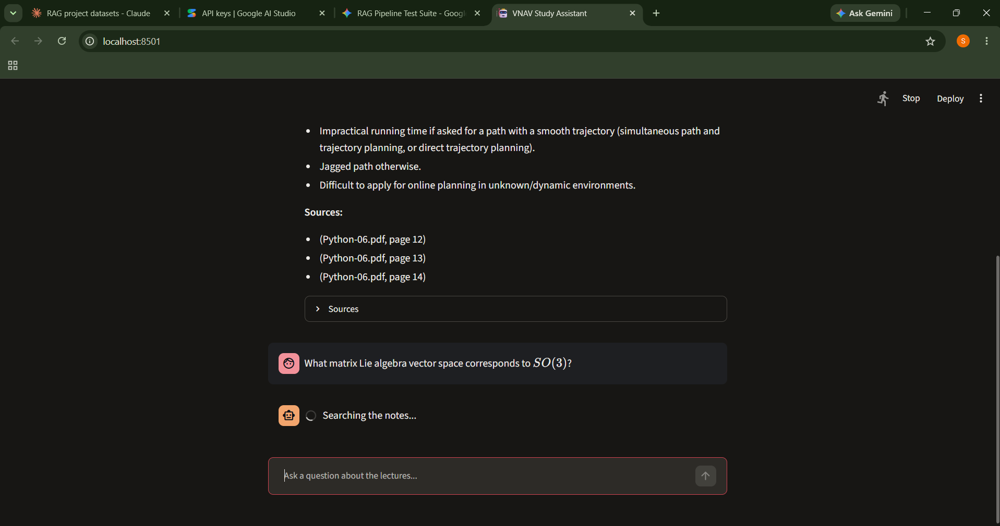
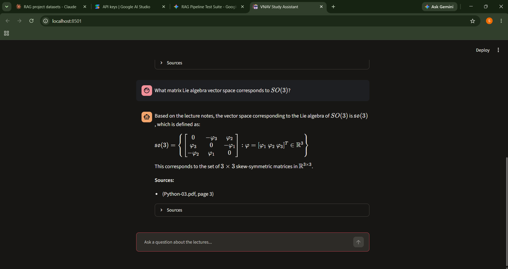

# VNAV Study Assistant (RAG)

A Retrieval-Augmented Generation assistant that answers questions about MIT's
*16.485: Visual Navigation for Autonomous Vehicles* lecture notes and cites the
file and page for every answer.




## How it works

PDFs → load and filter → chunk → embed (MiniLM) → store (Chroma)
→ question → retrieve top 20 → rerank (cross-encoder) → top 5 → Gemini answers with citations

- **Embeddings:** `sentence-transformers/all-MiniLM-L6-v2` (runs locally)
- **Vector DB:** Chroma
- **Reranker:** `cross-encoder/ms-marco-MiniLM-L-6-v2`
- **LLM:** Google Gemini API (with automatic retry and model fallback)
- **UI:** Streamlit

## Evaluation

Retrieval was evaluated on 20 hand-written questions (`questions.json`), each with
the correct source PDF and page(s). Metrics: hit@k (the correct page appears in
the top k results) and MRR (mean reciprocal rank).

| Configuration | hit@1 | hit@3 | hit@5 | MRR |
|---|---|---|---|---|
| Baseline (MiniLM, chunk 1500) | 70% | 90% | 100% | 0.81 |
| Chunk size 1000 | 80% | 95% | 95% | 0.86 |
| Chunk size 1000 + reranker | 85% | 100% | 100% | 0.93 |

Findings:
- Smaller chunks worked better for slide-style material; chunk size 2000 was the worst.
- MMR search did not improve results on this test set.
- bge-small (without a query prefix) scored lower than MiniLM.
- The reranker improved ranking, but equation-heavy questions remain the weakest
  area (one formula question dropped from rank 1 to rank 2).

All 16 configurations tested (2 embedding models x 4 chunk sizes x 2 search
methods) are reproducible with `experiments.py`.

## Limitations

- Small test set (20 questions); one question equals 5 percentage points.
- Questions were written by the author, so some are close to slide wording.
- Only retrieval was scored; the quality of generated answers was checked by hand.
- Text only. Diagrams and images in slides are not read.
- Weak on equations and symbols.

## Setup

1. Clone the repo and install the dependencies:
   ```
   pip install -r requirements.txt
   ```
2. Download lecture notes (PDFs) from [MIT OpenCourseWare](https://ocw.mit.edu)
   and place them in a folder named `data/`. The PDFs are not included in this repo.
3. Get a free Gemini API key at https://aistudio.google.com and set it:
   ```
   # PowerShell
   $env:GEMINI_API_KEY="your-key"
   ```
4. Build the index (run once):
   ```
   python ingest.py
   ```
5. Run the app:
   ```
   streamlit run app.py
   ```

## Files

| File | Purpose |
|---|---|
| `ingest.py` | Load PDFs, chunk, embed, store in Chroma |
| `rag.py` | Retrieval, reranking, and Gemini answer generation |
| `app.py` | Streamlit chat UI |
| `query.py` | Terminal version |
| `eval.py` | Hit rate and MRR on the test set |
| `experiments.py` | Compares embedding models, chunk sizes, search methods |
| `experiment_rerank.py` | Compares plain search against reranking |
| `questions.json` | 20-question evaluation set |

## Course material

Lecture notes belong to their authors and MIT OpenCourseWare and are licensed
under their respective terms. This project only contains code.